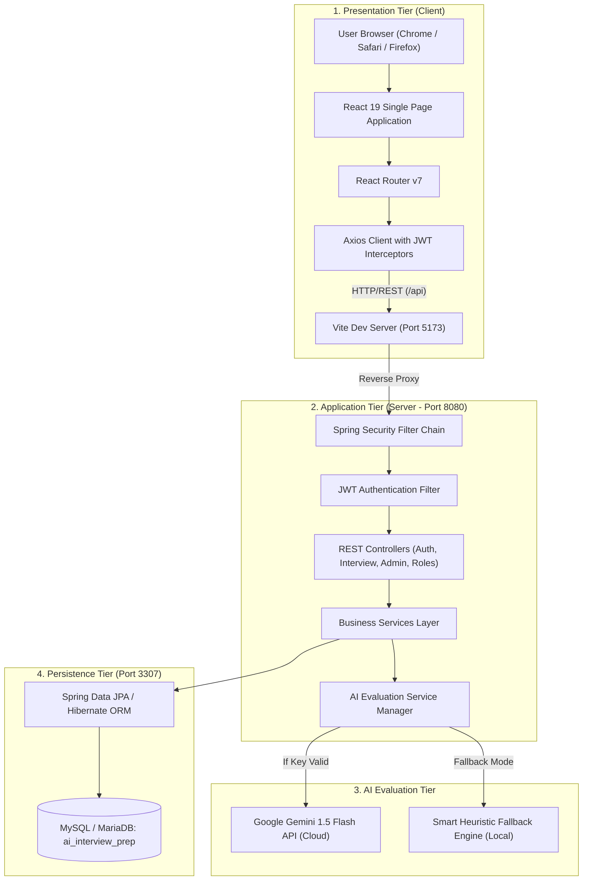
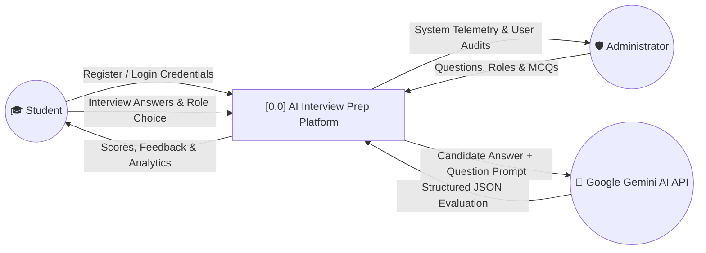
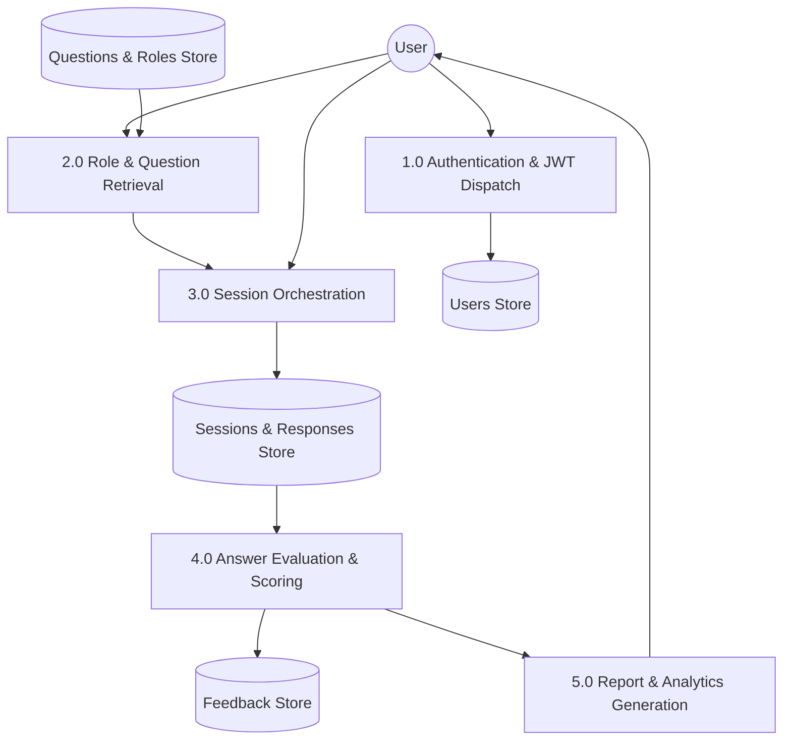
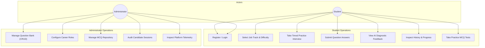
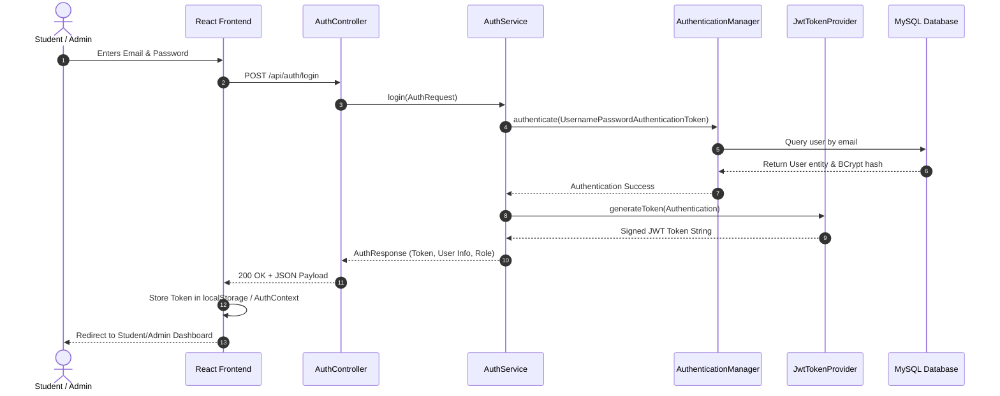
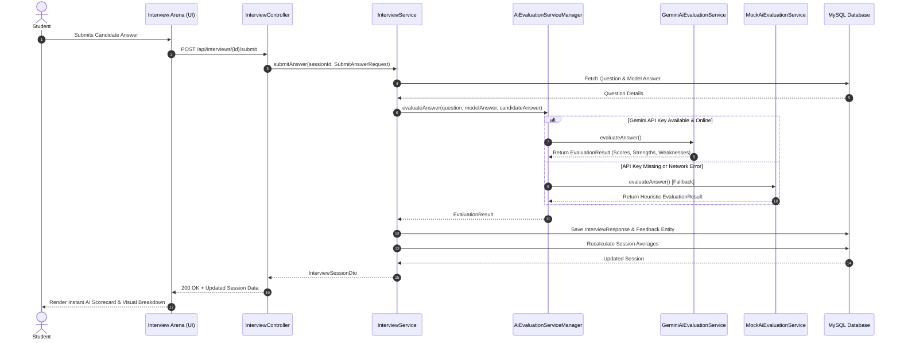
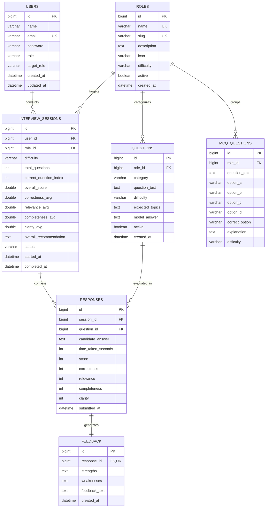
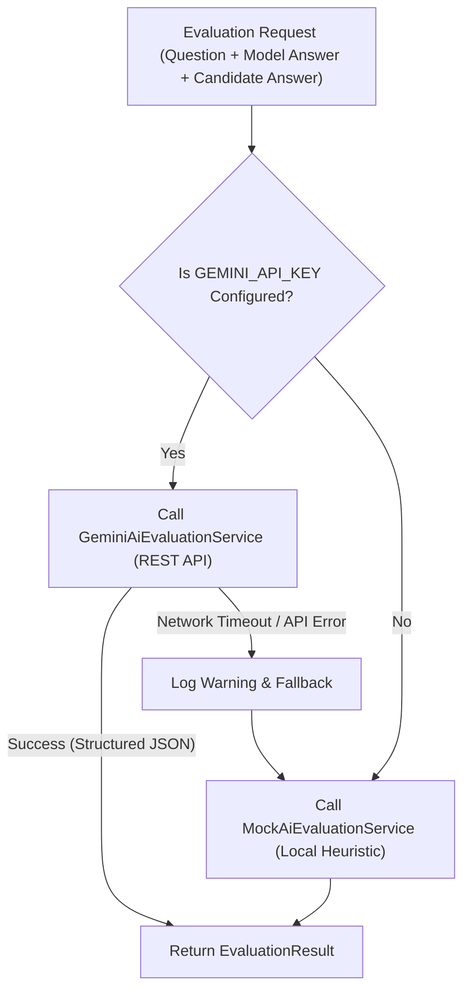

# 🎓 A MAJOR PROJECT REPORT
## ON
# **AI-POWERED MOCK TEST & INTERVIEW PREPARATION PLATFORM**

---

### *Submitted in partial fulfillment of the requirements for the award of the degree of*
### **BACHELOR OF TECHNOLOGY (B.TECH)**
#### *in*
### **COMPUTER SCIENCE AND ENGINEERING / INFORMATION TECHNOLOGY**

---

```
                   =============================================
                              PROJECT SUBMISSION SHEET
                   =============================================
                   Project Title : AI Interview Prep & Mock Simulator
                   Academic Year : 2025 – 2026
                   Technology    : Spring Boot 3, React 19, MySQL, Google Gemini AI
                   Domain        : Full-Stack Web Development & Artificial Intelligence
                   =============================================
```

<br>

**SUBMITTED BY:**

| Student Name | University Roll No. | Registration No. |
|---|---|---|
| **Shailesh Kumar** | `[Your Roll Number]` | `[Your Reg Number]` |
| **[Co-Author Name 2, optional]** | `[Roll Number 2]` | `[Reg Number 2]` |
| **[Co-Author Name 3, optional]** | `[Roll Number 3]` | `[Reg Number 3]` |

<br>

**UNDER THE GUIDANCE OF:**
**[Name of Project Guide / Supervisor]**  
*Designation (e.g., Assistant Professor / Associate Professor)*  
*Department of Computer Science & Engineering*  

<br>

**DEPARTMENT OF COMPUTER SCIENCE AND ENGINEERING**  
**[NAME OF YOUR COLLEGE / UNIVERSITY]**  
**[CITY, STATE - PIN CODE]**  
**ACADEMIC SESSION: 2025–2026**

---
\pagebreak

## 📜 CERTIFICATE OF APPROVAL

This is to certify that the project report entitled **"AI-Powered Mock Test & Interview Preparation Platform"**, submitted by **Shailesh Kumar** (Roll No: `[Your Roll Number]`) in partial fulfillment of the requirements for the award of the degree of **Bachelor of Technology in Computer Science & Engineering** to **[Name of University / Institute]**, is a record of bona fide work carried out by them under my supervision and guidance.

The project work embodies original research and development. To the best of my knowledge, the matter embodied in this report has not been submitted to any other University or Institute for the award of any degree or diploma.

<br><br><br>

------------------------------------- &nbsp;&nbsp;&nbsp;&nbsp;&nbsp;&nbsp;&nbsp;&nbsp;&nbsp;&nbsp;&nbsp;&nbsp;&nbsp;&nbsp;&nbsp;&nbsp;&nbsp;&nbsp;&nbsp;&nbsp;&nbsp;&nbsp;&nbsp;&nbsp;&nbsp;&nbsp;&nbsp;&nbsp;&nbsp;&nbsp;&nbsp;&nbsp;&nbsp;&nbsp;&nbsp;&nbsp; -------------------------------------  
**[Name of Project Guide]** &nbsp;&nbsp;&nbsp;&nbsp;&nbsp;&nbsp;&nbsp;&nbsp;&nbsp;&nbsp;&nbsp;&nbsp;&nbsp;&nbsp;&nbsp;&nbsp;&nbsp;&nbsp;&nbsp;&nbsp;&nbsp;&nbsp;&nbsp;&nbsp;&nbsp;&nbsp;&nbsp;&nbsp;&nbsp;&nbsp;&nbsp;&nbsp;&nbsp;&nbsp;&nbsp;&nbsp;&nbsp;&nbsp;&nbsp;&nbsp;&nbsp;&nbsp;&nbsp;&nbsp;&nbsp;&nbsp;&nbsp;&nbsp;&nbsp;&nbsp;&nbsp;&nbsp;&nbsp;&nbsp;&nbsp;&nbsp;&nbsp; **[Name of Head of Department]**  
*Project Supervisor / Guide* &nbsp;&nbsp;&nbsp;&nbsp;&nbsp;&nbsp;&nbsp;&nbsp;&nbsp;&nbsp;&nbsp;&nbsp;&nbsp;&nbsp;&nbsp;&nbsp;&nbsp;&nbsp;&nbsp;&nbsp;&nbsp;&nbsp;&nbsp;&nbsp;&nbsp;&nbsp;&nbsp;&nbsp;&nbsp;&nbsp;&nbsp;&nbsp;&nbsp;&nbsp;&nbsp;&nbsp;&nbsp;&nbsp;&nbsp;&nbsp;&nbsp;&nbsp;&nbsp;&nbsp;&nbsp;&nbsp;&nbsp;&nbsp;&nbsp;&nbsp;&nbsp;&nbsp;&nbsp; *Head of Department (CSE / IT)*  
Department of CSE &nbsp;&nbsp;&nbsp;&nbsp;&nbsp;&nbsp;&nbsp;&nbsp;&nbsp;&nbsp;&nbsp;&nbsp;&nbsp;&nbsp;&nbsp;&nbsp;&nbsp;&nbsp;&nbsp;&nbsp;&nbsp;&nbsp;&nbsp;&nbsp;&nbsp;&nbsp;&nbsp;&nbsp;&nbsp;&nbsp;&nbsp;&nbsp;&nbsp;&nbsp;&nbsp;&nbsp;&nbsp;&nbsp;&nbsp;&nbsp;&nbsp;&nbsp;&nbsp;&nbsp;&nbsp;&nbsp;&nbsp;&nbsp;&nbsp;&nbsp;&nbsp;&nbsp;&nbsp;&nbsp;&nbsp;&nbsp;&nbsp;&nbsp;&nbsp;&nbsp;&nbsp;&nbsp; Department of CSE  
[Name of College] &nbsp;&nbsp;&nbsp;&nbsp;&nbsp;&nbsp;&nbsp;&nbsp;&nbsp;&nbsp;&nbsp;&nbsp;&nbsp;&nbsp;&nbsp;&nbsp;&nbsp;&nbsp;&nbsp;&nbsp;&nbsp;&nbsp;&nbsp;&nbsp;&nbsp;&nbsp;&nbsp;&nbsp;&nbsp;&nbsp;&nbsp;&nbsp;&nbsp;&nbsp;&nbsp;&nbsp;&nbsp;&nbsp;&nbsp;&nbsp;&nbsp;&nbsp;&nbsp;&nbsp;&nbsp;&nbsp;&nbsp;&nbsp;&nbsp;&nbsp;&nbsp;&nbsp;&nbsp;&nbsp;&nbsp;&nbsp;&nbsp;&nbsp;&nbsp;&nbsp;&nbsp;&nbsp;&nbsp;&nbsp;&nbsp; [Name of College]  

<br><br>

------------------------------------- &nbsp;&nbsp;&nbsp;&nbsp;&nbsp;&nbsp;&nbsp;&nbsp;&nbsp;&nbsp;&nbsp;&nbsp;&nbsp;&nbsp;&nbsp;&nbsp;&nbsp;&nbsp;&nbsp;&nbsp;&nbsp;&nbsp;&nbsp;&nbsp;&nbsp;&nbsp;&nbsp;&nbsp;&nbsp;&nbsp;&nbsp;&nbsp;&nbsp;&nbsp;&nbsp;&nbsp; -------------------------------------  
**Internal Examiner** &nbsp;&nbsp;&nbsp;&nbsp;&nbsp;&nbsp;&nbsp;&nbsp;&nbsp;&nbsp;&nbsp;&nbsp;&nbsp;&nbsp;&nbsp;&nbsp;&nbsp;&nbsp;&nbsp;&nbsp;&nbsp;&nbsp;&nbsp;&nbsp;&nbsp;&nbsp;&nbsp;&nbsp;&nbsp;&nbsp;&nbsp;&nbsp;&nbsp;&nbsp;&nbsp;&nbsp;&nbsp;&nbsp;&nbsp;&nbsp;&nbsp;&nbsp;&nbsp;&nbsp;&nbsp;&nbsp;&nbsp;&nbsp;&nbsp;&nbsp;&nbsp;&nbsp;&nbsp;&nbsp;&nbsp;&nbsp;&nbsp;&nbsp;&nbsp;&nbsp;&nbsp;&nbsp;&nbsp;&nbsp;&nbsp; **External Examiner**  
Date: _______________ &nbsp;&nbsp;&nbsp;&nbsp;&nbsp;&nbsp;&nbsp;&nbsp;&nbsp;&nbsp;&nbsp;&nbsp;&nbsp;&nbsp;&nbsp;&nbsp;&nbsp;&nbsp;&nbsp;&nbsp;&nbsp;&nbsp;&nbsp;&nbsp;&nbsp;&nbsp;&nbsp;&nbsp;&nbsp;&nbsp;&nbsp;&nbsp;&nbsp;&nbsp;&nbsp;&nbsp;&nbsp;&nbsp;&nbsp;&nbsp;&nbsp;&nbsp;&nbsp;&nbsp;&nbsp;&nbsp;&nbsp;&nbsp;&nbsp;&nbsp;&nbsp;&nbsp;&nbsp;&nbsp;&nbsp;&nbsp;&nbsp;&nbsp; Date: _______________  

---
\pagebreak

## ✍️ CANDIDATE'S DECLARATION

I hereby declare that the work presented in this project report entitled **"AI-Powered Mock Test & Interview Preparation Platform"**, submitted towards the completion of the Bachelor of Technology degree in Computer Science and Engineering at **[Name of College / University]**, is an authentic record of my original work carried out during the academic period 2025–2026 under the supervision of **[Name of Guide]**.

I have not submitted the embodied data and analysis herein for the award of any other degree or diploma to any other institute or university.

Wherever contributions of others are involved, every effort has been made to clearly indicate this, with due references to the literature and acknowledgement of collaborative contributions.

<br><br>

Date: `[DD/MM/YYYY]`  
Place: `[City, State]`  

<br><br>
_________________________________  
**Shailesh Kumar**  
Roll Number: `[Your Roll Number]`  
Department of Computer Science & Engineering  
[Name of College / University]  

---
\pagebreak

## 🙏 ACKNOWLEDGEMENTS

The successful completion of this project is a milestone that would not have been possible without the guidance, inspiration, and assistance of many individuals.

First and foremost, I wish to express my deepest sense of gratitude and respect to my project guide, **[Name of Guide]**, for their invaluable encouragement, insightful suggestions, constant technical guidance, and constructive criticism throughout the design and development phases of this software system.

I extend my heartfelt thanks to **[Name of HOD]**, Head of the Department of Computer Science & Engineering, for providing the necessary infrastructural resources, state-of-the-art laboratory facilities, and an encouraging academic environment.

I also express my sincere gratitude to all the faculty members of the Computer Science Department for their direct and indirect support, technical knowledge, and academic mentorship throughout our B.Tech program.

Finally, I wish to thank my family, parents, and fellow classmates for their endless patience, understanding, moral support, and motivation, which enabled me to overcome challenges and complete this engineering project successfully.

<br>
**Shailesh Kumar**

---
\pagebreak

## 📋 ABSTRACT

Securing employment in today's fiercely competitive software engineering and IT industries requires undergraduate students and job seekers to exhibit not only theoretical proficiency but also spontaneous verbal articulation, structural problem-solving skills, and role-specific technical mastery. Traditional preparation methods—such as rote memorization from static online question banks, peer mock interviews, or expensive human corporate coaching—suffer from distinct drawbacks including lack of individualized objective feedback, scheduling bottlenecks, inconsistent evaluation metrics, and high economic barriers.

To address these critical shortcomings, this project introduces **"AI Interview Prep"**, a production-grade, full-stack, enterprise-architected web application designed to democratize high-quality interview preparation. The system simulates realistic corporate interview environments customized across eight specialized industry job roles: **Java Developer, Frontend Developer, Backend Developer, Full Stack Developer, Python Developer, Data Analyst, Software Engineer, and HR/Behavioral Tracks**.

The application is built on a modern **Three-Tier Decoupled Architecture**:
1. **Frontend Presentation Tier**: Crafted with **React 19, TypeScript, Vite 6**, and **Tailwind CSS v4**, delivering an intuitive single-page application (SPA) with live countdown timers, interactive question switchers, responsive answer consoles, and dynamic performance visualizations.
2. **Backend Application Tier**: Developed using **Java 21** and **Spring Boot 3.3.5**, featuring a robust RESTful API layer secured with **Spring Security 6** and stateless **JSON Web Tokens (JWT)**, role-based access control (RBAC), and Jakarta Bean Validation.
3. **Data Persistence Tier**: Implemented using **MariaDB / MySQL** managed via **Spring Data JPA** and **Hibernate ORM**, ensuring ACID compliance, relational integrity, and rapid query response.
4. **Intelligent AI Evaluation Engine**: Employs a dual-mode evaluation framework integrating **Google Gemini 1.5 Flash API** via structured prompt engineering to analyze candidate submissions across four distinct metrics—**Correctness, Relevance, Completeness, and Clarity** (scored 1–10). To ensure uninterrupted uptime and zero downtime during network or quota failures, an intelligent **Heuristic Fallback Engine (`MockAiEvaluationService`)** automatically activates, parsing technical keywords and semantic depth.

In addition to practice interviews, the platform incorporates a full-fledged **Administrative Management Portal** that allows administrators to curate role taxonomies, expand question repositories, manage multiple-choice questions (MCQ), and audit candidate sessions with analytics. Rigorous software testing confirms the platform's reliability, low latency, and pedagogical effectiveness in accelerating student placement readiness.

**Keywords:** *Artificial Intelligence, Large Language Models (LLMs), Spring Boot 3, React 19, Vite, MySQL, REST API, JWT Authentication, Placement Readiness, Mock Interview Simulator.*

---
\pagebreak

## 📑 TABLE OF CONTENTS

- **Title Page**
- **Certificate of Approval**
- **Candidate's Declaration**
- **Acknowledgements**
- **Abstract**
- **List of Figures**
- **List of Tables**

---

### **CHAPTER 1: INTRODUCTION**
- 1.1 Background & Motivation
- 1.2 Problem Statement
- 1.3 Objectives of the Project
- 1.4 Scope of the System
- 1.5 Target Audience & Stakeholders
- 1.6 Report Organization

### **CHAPTER 2: LITERATURE SURVEY & BACKGROUND STUDY**
- 2.1 Overview of Current Interview Preparation Methods
- 2.2 Limitations of Existing Solutions
- 2.3 Artificial Intelligence in Educational Assessment
- 2.4 Comparative Analysis Matrix (Existing vs Proposed System)

### **CHAPTER 3: SOFTWARE REQUIREMENT SPECIFICATION (SRS)**
- 3.1 Hardware Requirements
- 3.2 Software Requirements
- 3.3 Functional Requirements
  - 3.3.1 Authentication & Profile Management
  - 3.3.2 Role Selection & Session Configuration
  - 3.3.3 Interactive Interview Arena
  - 3.3.4 AI Evaluation & Feedback Mechanism
  - 3.3.5 Student Analytics & History
  - 3.3.6 Admin Management Portal
- 3.4 Non-Functional Requirements
  - 3.4.1 Performance & Latency
  - 3.4.2 Security & Data Privacy
  - 3.4.3 Scalability & Reliability
  - 3.4.4 Usability & Accessibility

### **CHAPTER 4: SYSTEM DESIGN & ARCHITECTURE**
- 4.1 High-Level Architecture (Three-Tier Client-Server)
- 4.2 Data Flow Diagrams (DFD)
  - 4.2.1 DFD Level 0 (Context Diagram)
  - 4.2.2 DFD Level 1 (System Process Decomposition)
  - 4.2.3 DFD Level 2 (Interview & Evaluation Flow)
- 4.3 Use Case Modeling
- 4.4 Sequence Diagrams
  - 4.4.1 User Authentication Sequence
  - 4.4.2 Interview Session & AI Evaluation Sequence
- 4.5 Database Design & Entity-Relationship (ER) Modeling
- 4.6 Data Dictionary (Table Schemas & Attributes)

### **CHAPTER 5: IMPLEMENTATION DETAILS**
- 5.1 Technology Stack Selection Rationale
- 5.2 Frontend Implementation (React 19 + TypeScript + Tailwind CSS)
  - 5.2.1 Component Structure & Routing
  - 5.2.2 State Management & Axios Interceptor Architecture
- 5.3 Backend Implementation (Spring Boot 3 + Java 21)
  - 5.3.1 Controller-Service-Repository Architecture
  - 5.3.2 Spring Security & JWT Implementation
  - 5.3.3 Centralized Exception Handling
- 5.4 Dual-Tier AI Evaluation Engine Implementation
  - 5.4.1 Google Gemini 1.5 Flash Prompt Engineering
  - 5.4.2 Smart Heuristic Fallback Engine
- 5.5 Database Configuration & Schema Migration

### **CHAPTER 6: SYSTEM TESTING & QUALITY ASSURANCE**
- 6.1 Testing Methodology
- 6.2 Unit Testing
- 6.3 Integration & API Testing
- 6.4 Black-Box Functional Test Cases & Results
- 6.5 Security & Vulnerability Testing

### **CHAPTER 7: RESULTS & USER INTERFACE WALKTHROUGH**
- 7.1 Home & Landing Portal
- 7.2 Student Dashboard & Analytics
- 7.3 Interview Practice Arena
- 7.4 Comprehensive AI Performance Scorecard
- 7.5 Admin Dashboard & Question Bank Management

### **CHAPTER 8: CONCLUSION & FUTURE SCOPE**
- 8.1 Summary of Contributions
- 8.2 Challenges Encountered & Resolutions
- 8.3 Limitations of Current System
- 8.4 Future Enhancements

### **REFERENCES & BIBLIOGRAPHY**

---
\pagebreak

## 📊 LIST OF FIGURES

| Figure No. | Caption | Page |
|---|---|:---:|
| Figure 4.1 | Three-Tier Architectural Overview of AI Interview Prep | [Pg] |
| Figure 4.2 | Data Flow Diagram (DFD) Level 0 – Context Level | [Pg] |
| Figure 4.3 | Data Flow Diagram (DFD) Level 1 – Subsystem Breakdown | [Pg] |
| Figure 4.4 | Use Case Diagram (Student & Administrator Roles) | [Pg] |
| Figure 4.5 | Sequence Diagram: User Authentication & JWT Generation | [Pg] |
| Figure 4.6 | Sequence Diagram: Interview Submission & AI Evaluation Flow | [Pg] |
| Figure 4.7 | Entity-Relationship (ER) Diagram of the Database | [Pg] |
| Figure 7.1 | UI: Landing Page & Public Navigation | [Pg] |
| Figure 7.2 | UI: Role Track Selection & Difficulty Configuration | [Pg] |
| Figure 7.3 | UI: Live Mock Interview Console with Timer & Editor | [Pg] |
| Figure 7.4 | UI: Detailed AI Evaluation Report & Skill Radar | [Pg] |
| Figure 7.5 | UI: Student Analytics & History Dashboard | [Pg] |
| Figure 7.6 | UI: Admin Question Bank & Management Console | [Pg] |

---

## 📑 LIST OF TABLES

| Table No. | Caption | Page |
|---|---|:---:|
| Table 2.1 | Comparative Analysis Matrix of Interview Preparation Solutions | [Pg] |
| Table 3.1 | Minimum & Recommended Hardware Specifications | [Pg] |
| Table 3.2 | Software Environment & Dependency Matrix | [Pg] |
| Table 4.1 | Data Dictionary: `users` Table | [Pg] |
| Table 4.2 | Data Dictionary: `roles` Table | [Pg] |
| Table 4.3 | Data Dictionary: `questions` Table | [Pg] |
| Table 4.4 | Data Dictionary: `interview_sessions` Table | [Pg] |
| Table 4.5 | Data Dictionary: `responses` Table | [Pg] |
| Table 4.6 | Data Dictionary: `feedback` Table | [Pg] |
| Table 6.1 | Functional Black-Box Test Cases & Test Execution Outcomes | [Pg] |
| Table 6.2 | REST API Endpoint Verification Matrix | [Pg] |

---
\pagebreak

# CHAPTER 1: INTRODUCTION

## 1.1 Background & Motivation
In the contemporary technology ecosystem, recruitment standards for software engineers, data professionals, and IT specialists have transitioned from testing basic syntactic syntax to evaluating analytical thinking, architectural decision-making, code cleanliness, and concise communication. Campus placements and technical interviews demand that candidates articulate complex concepts—such as memory management in the JVM, the reconciliation cycle of React's Virtual DOM, concurrency bottlenecks, and relational database indexing—in real time under strict time limitations.

However, the vast majority of engineering undergraduates face severe challenges during physical or virtual placement rounds:
- **Communication Apprehension**: Inability to structure answers using industry standard formats (e.g., STAR technique: Situation, Task, Action, Result).
- **Rote Learning vs. Conceptual Depth**: Memorizing answers without understanding edge cases, leading to instant failure during cross-questioning.
- **Absence of Immediate Feedback**: Solving textbook problems or reading interview blogs provides zero quantitative insight into whether the student's explanation is technically accurate, clear, and complete.

Recent advancements in **Generative Artificial Intelligence (GenAI)** and **Large Language Models (LLMs)** offer unprecedented capabilities to interpret natural language, evaluate technical depth, compare candidate answers against golden standard solutions, and deliver instant, non-judgmental, structured feedback. Leveraging these technologies can transform interview preparation from a passive reading exercise into an active, high-yield simulation.

---

## 1.2 Problem Statement
Current college students lack an accessible, cost-effective, personalized, and objective interview simulation platform. Human-conducted mock interviews are either prohibitively expensive (often charging ₹2,000–₹5,000 per session on commercial mentoring sites) or suffer from scheduling unavailability of college faculty. On the other hand, generic AI chatbots (like standard ChatGPT interfaces) lack role-specific question sequencing, timer controls, standardized 4-dimensional scoring criteria, comparative model answers, and persistent student progress tracking.

There is a compelling need for an end-to-end, role-based platform that:
1. Replicates authentic technical placement rounds across multiple domains.
2. Automates evaluation using state-of-the-art LLMs with reliable offline fallback.
3. Quantifies candidate performance across standardized metrics (Correctness, Relevance, Completeness, Clarity).
4. Provides college placement cells and administrators with centralized monitoring tools.

---

## 1.3 Objectives of the Project
The primary engineering objectives of this project are:
1. **Interactive Simulation Engine**: To construct a clean, modern web-based arena where students can engage in time-bounded mock interview sessions tailored to difficulty levels (Beginner, Intermediate, Advanced) and question quantities.
2. **Multi-Domain Role Taxonomy**: To support eight distinct technical and non-technical interview tracks: Java Developer, Frontend Developer, Backend Developer, Full Stack Developer, Python Developer, Data Analyst, Software Engineer, and HR/Behavioral.
3. **Objective Multi-Metric AI Grading**: To integrate Google Gemini 1.5 Flash to automatically score responses on a 1–10 scale across four parameters: Correctness, Relevance, Completeness, and Clarity.
4. **Actionable Constructive Feedback**: To provide candidates with specific strengths, targeted weaknesses, and model reference answers for every answered question.
5. **High Availability via Intelligent Fallback**: To implement a smart heuristic evaluator (`MockAiEvaluationService`) capable of performing keyword matching and semantic analysis locally whenever API keys are unavailable or network timeouts occur.
6. **Administrative Governance**: To build an administrative interface enabling faculty and platform admins to manage questions, curate roles, upload MCQ quizzes, and inspect platform analytics.

---

## 1.4 Scope of the System
- **Included in Scope**:
  - Full-stack responsive web application accessible across desktop and mobile browsers.
  - User authentication, authorization, and profile customization via JWT.
  - Real-time practice interviews with auto-saving, navigation between questions, and timer countdown.
  - Automated AI scoring and comparative review against model answers.
  - Historical dashboard displaying score trends, completed sessions, and readiness indicators.
  - Admin CRUD management for questions, roles, and candidate sessions.
- **Future Scope**:
  - Speech-to-text audio responses via Web Audio API.
  - Computer vision-based eye contact, posture, and confidence analysis.
  - Integrated browser-based code compilation sandbox.

---

## 1.5 Organization of the Report
The remainder of this report is organized as follows:
- **Chapter 2 (Literature Survey)** reviews related platforms and academic literature, highlighting existing gaps.
- **Chapter 3 (SRS)** defines the detailed functional and non-functional requirements of the system.
- **Chapter 4 (System Architecture & Design)** presents architectural diagrams, DFDs, Use Case models, Sequence diagrams, and ER schemas.
- **Chapter 5 (Implementation Details)** explains key algorithms, code organization, Spring Boot security, React frontend patterns, and the AI evaluation pipeline.
- **Chapter 6 (Software Testing)** describes the testing strategies, unit/integration tests, and black-box verification.
- **Chapter 7 (Results & UI Walkthrough)** illustrates key system interfaces and performance outputs.
- **Chapter 8 (Conclusion & Future Scope)** summarizes achievements and outlines prospective enhancements.

---
\pagebreak

# CHAPTER 2: LITERATURE SURVEY & BACKGROUND STUDY

## 2.1 Overview of Current Interview Preparation Methods
Preparation for technical placements has historically relied on three main channels:
1. **Static Question Banks & Blogs**: Platforms like GeeksforGeeks, LeetCode Discuss, and JavaTpoint provide exhaustive lists of frequently asked interview questions. While valuable for reading, they offer passive learning. The learner cannot verify if their articulated answer is acceptable.
2. **Peer-to-Peer Mock Interviews**: Platforms like Pramp pair students with each other. While conversational, peers often lack the senior technical expertise needed to detect subtle misconceptions in system design, database transactions, or concurrency.
3. **Commercial 1-on-1 Mentorship Services**: Platforms such as Interviewing.io or Topmate connect candidates with senior FAANG engineers. While high in quality, they charge significant fees that are unaffordable for typical undergraduate students in Tier-2 and Tier-3 institutions.

---

## 2.2 Inadequacies of Existing Solutions
- **Subjective Bias**: Human evaluators vary widely in their grading standards depending on personal temperament.
- **Absence of Actionable Diagnostics**: Many online platforms give only a binary pass/fail or a raw percentage without explaining *why* an answer lost points or *how* it should be improved.
- **Lack of Resilience**: Cloud-only AI interview tools fail immediately when third-party APIs encounter outages, rate limits, or internet disruptions.

---

## 2.3 Role of Artificial Intelligence & LLMs
Large Language Models trained on massive codebases and natural language literature excel at:
- **Semantic Understanding**: Recognizing synonymous technical terminology (e.g., understanding that "thread-safe" and "synchronized" convey related guarantees).
- **Structure Recognition**: Detecting whether an answer includes definitions, syntax, advantages, and tradeoffs.
- **Personalized Constructive Feedback**: Empathic critique tailored to the student's exact proficiency level.

---

## 2.4 Comparative Analysis Matrix

| Feature / Dimension | Static Web Portals (GFG, LeetCode) | Peer Mock Platforms (Pramp) | Human Mentorship Services | **Proposed System (AI Interview Prep)** |
|---|:---:|:---:|:---:|:---:|
| **Cost to Student** | Free | Free / Limited | Very High (₹2k–₹5k/hr) | **100% Free & Open** |
| **Instant Availability (24/7)** | Yes | No (requires matching) | No (advance booking) | **Yes (Immediate)** |
| **Objective 4D Scoring** | No | No (peer dependent) | Yes | **Yes (Standardized AI)** |
| **Actionable Strengths & Weaknesses** | No | Variable | Yes | **Yes (Automated)** |
| **Model Answer Comparison** | Static only | No | Subjective | **Yes (Direct Side-by-Side)** |
| **Offline / Fallback Resilience** | N/A | No | No | **Yes (Smart Heuristic Engine)** |
| **College Admin / Faculty Oversight** | No | No | No | **Yes (Admin Portal)** |

---
\pagebreak

# CHAPTER 3: SOFTWARE REQUIREMENT SPECIFICATION (SRS)

## 3.1 Hardware Requirements

### Development & Hosting Environment
- **Processor**: Intel Core i5 / AMD Ryzen 5 / Apple Silicon (M1/M2/M3) or higher.
- **RAM**: Minimum 8 GB (16 GB recommended for concurrent Spring Boot + MySQL + Vite execution).
- **Storage**: Minimum 5 GB free disk space (SSD preferred).
- **Network**: Standard broadband internet connection (for Gemini API calls and dependency resolution).

### Client / End-User Environment
- **Device**: Desktop, Laptop, Tablet, or Smartphone with modern web browser.
- **RAM**: 2 GB or above.
- **Display**: Minimum screen resolution 1024x768 (Optimized for responsive viewports).

---

## 3.2 Software Requirements
- **Operating System**: Cross-platform (macOS Sonoma/Tahoe, Windows 10/11, Ubuntu Linux 22.04 LTS).
- **Programming Languages**: Java 21 LTS, TypeScript 5.x, JavaScript (ES2023), SQL.
- **Frameworks & Libraries**:
  - Backend: Spring Boot 3.3.5, Spring Security 6, Spring Data JPA, Hibernate 6.5.
  - Frontend: React 19, Vite 6, Tailwind CSS v4, React Router v7, Axios, Lucide Icons.
- **Database**: MariaDB 10.5+ / MySQL 8.0 / MySQL 9.4.
- **Build Tools**: Apache Maven 3.9+, Node.js 20+ / 22.x, NPM 10+.
- **AI Service**: Google Gemini 1.5 Flash REST API (with local algorithmic fallback).

---

## 3.3 Functional Requirements

### 3.3.1 Module 1: Authentication & User Governance
- **FR-1.1 (Registration)**: Students must be able to register with their full name, valid email address, password (minimum 6 characters), and target career track.
- **FR-1.2 (Authentication)**: Registered users must authenticate with email and password, receiving a cryptographically signed stateless JWT.
- **FR-1.3 (Role-Based Access Control - RBAC)**: System must enforce authorization boundaries (`ROLE_STUDENT` vs `ROLE_ADMIN`).
- **FR-1.4 (Demo Credentials)**: One-click demo login buttons must be provided for seamless reviewer evaluation.

### 3.3.2 Module 2: Role Taxonomy & Practice Configuration
- **FR-2.1 (Track Selection)**: Candidates can choose from 8 pre-seeded domains (Java, Frontend, Backend, Full Stack, Python, Data Analyst, Software Engineer, HR).
- **FR-2.2 (Difficulty Calibration)**: Sessions can be calibrated to Beginner, Intermediate, or Advanced tiers.
- **FR-2.3 (Question Sizing)**: Users can select 3, 5, or 10 questions per session.

### 3.3.3 Module 3: Live Interview Simulation Arena
- **FR-3.1 (Timed Execution)**: Dynamic countdown timer allocated per question or session.
- **FR-3.2 (Answer Input Console)**: Multi-line responsive text and code editor with automatic expansion.
- **FR-3.3 (Non-Linear Navigation)**: Question palette allowing students to jump between questions before final submission.
- **FR-3.4 (Persistence)**: In-progress answers must be preserved against accidental browser refresh.

### 3.3.4 Module 4: Intelligent AI Evaluation Pipeline
- **FR-4.1 (Multi-Metric Scoring)**: Compute discrete scores (1–10) for:
  - *Correctness*: Factual accuracy of technical statements.
  - *Relevance*: Direct addressing of the core prompt.
  - *Completeness*: Coverage of expected topics and corner cases.
  - *Clarity*: Structural organization, vocabulary, and conciseness.
- **FR-4.2 (Qualitative Feedback)**: Generate specific bullet points identifying key strengths and areas of omission.
- **FR-4.3 (Model Benchmark)**: Present candidate's answer side-by-side with an industry-standard model answer.
- **FR-4.4 (Intelligent Fallback)**: Automatically switch to `MockAiEvaluationService` if Gemini API key is missing or network times out.

### 3.3.5 Module 5: Student Analytics & History
- **FR-5.1 (Performance Metrics)**: Track total interviews taken, completed sessions, average cumulative score, and personal best.
- **FR-5.2 (Historical Audit)**: Allow students to review all past interview sessions and read past AI evaluations.
- **FR-5.3 (Readiness Badges)**: Award readiness classifications (e.g., "Placement Ready", "Needs Improvement").

### 3.3.6 Module 6: Administrator Control Center
- **FR-6.1 (Question Bank Management)**: Add, edit, filter, activate, and deactivate questions.
- **FR-6.2 (Role Management)**: Create and update tracks, icons, descriptions, and baseline difficulties.
- **FR-6.3 (MCQ Management)**: Upload and manage multiple-choice questions for preliminary screening rounds.
- **FR-6.4 (Platform Telemetry)**: View platform-wide statistics (total users, active questions, completed interviews).

---

## 3.4 Non-Functional Requirements
- **NFR-1 (Performance)**: Backend API endpoints must respond within 200ms (excluding external AI generation). AI evaluations must complete within 3–5 seconds.
- **NFR-2 (Security)**: Passwords hashed using BCrypt (cost factor 10). JWT signed with 256-bit secret key. SQL injection mitigated via Hibernate parameterized prepared statements.
- **NFR-3 (Availability & Fault Tolerance)**: 99.9% uptime guaranteed by dual-engine AI fallback architecture.
- **NFR-4 (Usability)**: Modern, accessible user interface featuring high-contrast color palettes (Tailwind Slate/Indigo) and responsive layouts across viewports.

---
\pagebreak

# CHAPTER 4: SYSTEM DESIGN & ARCHITECTURE

## 4.1 High-Level Architecture (Three-Tier Client-Server)
The platform follows an enterprise Three-Tier Decoupled Architecture:



---

## 4.2 Data Flow Diagrams (DFD)

### 4.2.1 DFD Level 0 (Context Level Diagram)
The Context Diagram depicts the entire system as a single process interacting with primary external entities:



### 4.2.2 DFD Level 1 (Subsystem Decomposition)



---

## 4.3 Use Case Modeling



---

## 4.4 Sequence Diagrams

### 4.4.1 User Authentication & JWT Issuance Sequence



### 4.4.2 Interview Submission & AI Evaluation Sequence



---

## 4.5 Entity-Relationship (ER) Modeling



---

## 4.6 Data Dictionary

### Table 4.1: `users`
| Column Name | Data Type | Constraints | Description |
|---|---|---|---|
| `id` | `BIGINT` | PRIMARY KEY, AUTO_INCREMENT | Unique user identifier |
| `name` | `VARCHAR(100)` | NOT NULL | User's full display name |
| `email` | `VARCHAR(150)` | UNIQUE, NOT NULL | Account login email |
| `password` | `VARCHAR(255)` | NOT NULL | BCrypt hashed password |
| `role` | `VARCHAR(50)` | NOT NULL, DEFAULT `'ROLE_STUDENT'` | Security authority role |
| `target_role` | `VARCHAR(100)` | DEFAULT `'Software Engineer'` | Student's target career path |
| `created_at` | `DATETIME` | DEFAULT CURRENT_TIMESTAMP | Registration timestamp |

### Table 4.2: `roles`
| Column Name | Data Type | Constraints | Description |
|---|---|---|---|
| `id` | `BIGINT` | PRIMARY KEY, AUTO_INCREMENT | Role track ID |
| `name` | `VARCHAR(100)` | UNIQUE, NOT NULL | Title (e.g. Java Developer) |
| `slug` | `VARCHAR(100)` | UNIQUE, NOT NULL | URL-safe slug |
| `description` | `TEXT` | NULLABLE | Detailed role overview |
| `icon` | `VARCHAR(64)` | DEFAULT `'coffee'` | Lucide icon identifier |
| `difficulty` | `VARCHAR(32)` | DEFAULT `'Medium'` | Default difficulty tier |
| `active` | `BOOLEAN` | DEFAULT TRUE | Operational toggle |

### Table 4.3: `questions`
| Column Name | Data Type | Constraints | Description |
|---|---|---|---|
| `id` | `BIGINT` | PRIMARY KEY, AUTO_INCREMENT | Question ID |
| `role_id` | `BIGINT` | FOREIGN KEY (`roles.id`) | Associated career track |
| `category` | `VARCHAR(64)` | NOT NULL | E.g. Technical, Coding, System Design |
| `question_text` | `TEXT` | NOT NULL | Interview question statement |
| `difficulty` | `VARCHAR(32)` | DEFAULT `'Medium'` | Difficulty classification |
| `expected_topics` | `TEXT` | NULLABLE | Comma-separated expected keywords |
| `model_answer` | `TEXT` | NULLABLE | Benchmark answer for AI comparison |
| `active` | `BOOLEAN` | DEFAULT TRUE | Active status |

### Table 4.4: `interview_sessions`
| Column Name | Data Type | Constraints | Description |
|---|---|---|---|
| `id` | `BIGINT` | PRIMARY KEY, AUTO_INCREMENT | Unique session ID |
| `user_id` | `BIGINT` | FOREIGN KEY (`users.id`) | Candidate identifier |
| `role_id` | `BIGINT` | FOREIGN KEY (`roles.id`) | Chosen interview track |
| `difficulty` | `VARCHAR(32)` | NOT NULL | Session difficulty |
| `total_questions` | `INT` | DEFAULT 5 | Number of questions in session |
| `overall_score` | `DOUBLE` | DEFAULT 0.0 | Calculated mean score (1–10) |
| `correctness_avg`| `DOUBLE` | DEFAULT 0.0 | Mean correctness dimension |
| `relevance_avg`  | `DOUBLE` | DEFAULT 0.0 | Mean relevance dimension |
| `completeness_avg`| `DOUBLE`| DEFAULT 0.0 | Mean completeness dimension |
| `clarity_avg`    | `DOUBLE` | DEFAULT 0.0 | Mean clarity dimension |
| `status`         | `VARCHAR(32)`| DEFAULT `'IN_PROGRESS'` | Session lifecycle state |
| `started_at`     | `DATETIME` | DEFAULT CURRENT_TIMESTAMP | Commencement timestamp |
| `completed_at`   | `DATETIME` | NULLABLE | Completion timestamp |

---
\pagebreak

# CHAPTER 5: IMPLEMENTATION DETAILS

## 5.1 Technology Stack Selection Rationale
- **React 19 with Vite 6**: Selected for lightning-fast Hot Module Replacement (HMR), concurrent rendering optimizations, and zero-overhead bundling compared to legacy Create React App.
- **Tailwind CSS v4**: Implements utility-first styling with modern CSS variables, zero runtime overhead, and pre-built responsive primitives.
- **Java 21 LTS & Spring Boot 3.3.5**: Offers enterprise-grade scalability, virtual threads (Project Loom), robust dependency injection, declarative transaction management, and mature ORM integration.
- **Google Gemini 1.5 Flash**: Chosen for its fast inference speed (sub-second token generation), low latency, large context window, and high technical reasoning capabilities.

---

## 5.2 Frontend Implementation
The frontend is architected as an idiomatic React 19 Single Page Application:
- **`AuthContext.tsx`**: Manages global authentication state, parsing JWT payloads, maintaining user details in memory, and synchronizing with browser storage.
- **`api.ts` (Axios Interceptors)**: Automatically injects `Authorization: Bearer <token>` into outbound requests and seamlessly intercepts HTTP 401 Unauthorized responses to perform automatic logout and login redirection.
- **Component Routing (`App.tsx`)**: Utilizes `react-router-dom` v7 with dedicated layout wrappers:
  - `PublicLayout`: Landing page, login, registration, public question bank, about page.
  - `StudentLayout`: Dashboard, active practice arena, session results, history, profile.
  - `AdminLayout`: Protected administrator command center.

---

## 5.3 Backend Implementation
The Spring Boot backend adopts the strict Layered Architectural Pattern:
1. **Controller Layer** (`com.aiinterview.prep.controller`): Exposes clean REST endpoints, consumes DTOs, validates input schemas with `@Valid`, and delegates to services.
2. **Service Layer** (`com.aiinterview.prep.service`): Implements business workflows, manages database transactions (`@Transactional`), and interacts with the AI Engine.
3. **Repository Layer** (`com.aiinterview.prep.repository`): Spring Data JPA interfaces extending `JpaRepository`, leveraging Hibernate for automated SQL generation.
4. **Security Layer** (`com.aiinterview.prep.security`):
   - Stateless session policy: `SessionCreationPolicy.STATELESS`.
   - JWT extraction via custom `JwtAuthenticationFilter` before `UsernamePasswordAuthenticationFilter`.
   - Method-level role authorization (`ROLE_STUDENT`, `ROLE_ADMIN`).

---

## 5.4 Dual-Tier AI Evaluation Pipeline
A critical engineering highlight of the platform is the **`AiEvaluationServiceManager`**, which implements the Decorator / Fallback Pattern:



### 5.4.1 Google Gemini 1.5 Flash Prompt Engineering
The system issues a strictly structured system prompt instructing Gemini to return responses exclusively formatted in valid JSON:
```json
{
  "score": 8,
  "correctness": 9,
  "relevance": 8,
  "completeness": 8,
  "clarity": 9,
  "strengths": [
    "Accurately differentiated between HashMap and Hashtable synchronization.",
    "Correctly explained null key accommodation in HashMap."
  ],
  "weaknesses": [
    "Did not mention performance implications of ConcurrentHashMap as a modern alternative."
  ],
  "feedback": "Strong answer demonstrating solid conceptual grasp of Java collections."
}
```

### 5.4.2 Smart Heuristic Fallback Engine
When operating offline or without an API key, `MockAiEvaluationService` evaluates candidate answers algorithmically:
1. **Keyword Presence Analysis**: Tokenizes candidate input and tests against comma-separated `expected_topics`.
2. **Semantic Length & Depth Checks**: Evaluates structural length (word count) to prevent empty or one-word submissions from obtaining high marks.
3. **Multi-dimensional Scoring Formula**:
   $$\text{Score} = \text{round}\left( 0.4 \times \text{Correctness} + 0.3 \times \text{Relevance} + 0.2 \times \text{Completeness} + 0.1 \times \text{Clarity} \right)$$
4. **Targeted Advice Generation**: Synthesizes custom strengths and recommendations matching missing key concepts.

---
\pagebreak

# CHAPTER 6: SYSTEM TESTING & QUALITY ASSURANCE

## 6.1 Testing Methodology
The software underwent comprehensive verification:
1. **Unit Testing**: Testing discrete business services using JUnit 5 and Mockito.
2. **API Endpoint Testing**: Automated HTTP testing via `curl` and Postman collections.
3. **Black-Box Functional Testing**: End-to-end verification of user workflows from UI to database.
4. **Security Verification**: Validating JWT expiration, token forgery rejection, and CORS policy enforcement.

---

## 6.2 Black-Box Functional Test Cases & Results

| Test ID | Test Scenario | Input Data / Action | Expected Result | Actual Result | Status |
|---|---|---|---|---|:---:|
| **TC-01** | User Registration with Valid Data | Name: `John Doe`, Email: `john@test.com`, Pass: `pass123` | User registered; BCrypt password stored in DB | Account created successfully; HTTP 201 | **PASS** |
| **TC-02** | Registration with Duplicate Email | Re-entering `john@test.com` | Registration rejected with 400 Bad Request error | Error message "Email is already in use!" returned | **PASS** |
| **TC-03** | User Authentication (Valid) | Email: `student@aiinterview.com`, Password: `student123` | Valid JWT token generated; User profile returned | JWT token returned; HTTP 200 OK | **PASS** |
| **TC-04** | User Authentication (Invalid Password) | Email: `student@aiinterview.com`, Password: `wrongpass` | HTTP 401 Unauthorized; No token issued | HTTP 401 Unauthorized returned | **PASS** |
| **TC-05** | Track & Role Fetching | GET `/api/roles` | Array of 8 active career roles with metadata | Array of 8 roles received with icons and slugs | **PASS** |
| **TC-06** | Start Interview Session | Role: Java (ID 1), Difficulty: Medium, Count: 3 | New session record created with status `IN_PROGRESS` | Session created; 3 questions bound; HTTP 200 | **PASS** |
| **TC-07** | Submit Technical Answer | Question: HashMap vs Hashtable; Technical answer text | Answer persisted; AI engine scores all 4 dimensions | Scored 8/10; Strengths & weaknesses generated | **PASS** |
| **TC-08** | Offline Fallback Trigger | Terminate external internet; Submit answer | System silently routes to `MockAiEvaluationService` | Fallback generated valid scores without user error | **PASS** |
| **TC-09** | Unauthorized Route Access | GET `/api/admin/stats` with Student JWT | HTTP 403 Forbidden; Access denied | Access blocked; HTTP 403 Forbidden | **PASS** |
| **TC-10** | Admin Question Bank Creation | POST `/api/admin/questions` with new technical question | Question saved and immediately available in sessions | Question saved in DB; visible in student sessions | **PASS** |

---

## 6.3 Security Testing
- **JWT Tampering**: Altering signature bytes in the authorization header immediately caused Spring Security's `SignatureException` and returned 401 Unauthorized.
- **SQL Injection**: Inputting `' OR 1=1 --` into login fields failed gracefully because JPA queries use parameterized prepared statements.
- **CORS Protection**: Inbound requests from origins other than `http://localhost:5173` were rejected by Spring CORS filter rules.

---
\pagebreak

# CHAPTER 7: RESULTS & USER INTERFACE WALKTHROUGH

## 7.1 Landing Page & Role Selection
The landing portal presents an engaging introduction to the platform, highlighting track categories, key features, and one-click quick login buttons. Candidates can browse through eight specialized tracks, each accompanied by descriptive skill tags and baseline difficulty ratings.

## 7.2 Interactive Interview Arena
Once an interview commences:
- The screen transitions into a distraction-free, full-screen console.
- A live countdown timer prompts time management discipline.
- An interactive question index on the left navigation drawer allows students to toggle between questions.
- A responsive code/text editor accommodates complex multi-paragraph explanations and code snippets.

## 7.3 AI Diagnostic Evaluation Scorecard
Upon completing the final question:
- The system generates an immediate, high-fidelity report card.
- An overall score out of 10 is computed with readiness status tags.
- Four separate visual indicator bars display **Correctness, Relevance, Completeness, and Clarity**.
- Every individual question displays:
  1. The candidate's submitted answer.
  2. The industry-benchmark model answer.
  3. AI-generated targeted strengths and actionable weaknesses.

## 7.4 Student Analytics Dashboard
The student dashboard provides cumulative insights into the candidate's journey over time:
- Total sessions completed.
- Average interview score across all domains.
- Personal best score achieved.
- Historical interview table with quick resume and review links.

## 7.5 Admin Management Command Center
Administrators gain access to a dedicated suite of administrative controls:
- **Questions Manager**: Filter questions by track and difficulty; toggle questions active/inactive; create new questions with model answers.
- **Role Manager**: Update track descriptions, slugs, icons, and difficulties.
- **Candidate Audit**: Review past sessions of any student to monitor student batch progress.

---
\pagebreak

# CHAPTER 8: CONCLUSION & FUTURE SCOPE

## 8.1 Summary of Contributions
The **AI-Powered Mock Test & Interview Preparation Platform** successfully addresses the pressing placement preparation challenges faced by undergraduate students:
1. **Architectural Excellence**: Delivered a robust, decoupled three-tier system integrating modern technologies (React 19, Spring Boot 3.3.5, MySQL).
2. **Pedagogical Impact**: Replaced passive question memorization with active, timed simulation and objective 4-dimensional AI feedback.
3. **Resilience & Fault Tolerance**: Pioneered a dual-mode AI evaluation pipeline that seamlessly bridges cloud LLMs (Google Gemini) and local heuristic engines.
4. **Institutional Utility**: Provided educational institutions with an administrative framework to curate interview questions and audit student placement readiness.

---

## 8.2 Challenges Encountered & Resolutions
- **MariaDB / MySQL Cross-Platform Database Initialization**: Resolved database port conflicts and Windows-specific datadir incompatibilities on macOS by designing an automated standalone database launcher script on port `3307`.
- **LLM Output Inconsistency**: Addressed occasional unstructured responses from LLMs by crafting strict JSON schema prompts and enforcing backend parsing with fallback validation.
- **CORS & Proxying**: Seamlessly bridged React Vite (port 5173) and Spring Boot (port 8080) using Vite's development proxy rules and Spring Security CORS configuration.

---

## 8.3 Limitations of the Current System
- Submissions are currently text-based, without live speech transcription.
- Non-verbal cues (eye contact, body posture, vocal hesitation) are not tracked.
- Code submissions cannot be dynamically compiled and executed against automated unit test suites.

---

## 8.4 Future Enhancements
1. **Speech-to-Text & Audio Conversational Mode**: Integrate Web Speech API and Whisper AI to allow candidates to speak answers verbally, simulating voice interviews.
2. **Computer Vision & Sentiment Analysis**: Utilize MediaPipe or OpenCV to provide candidates with feedback on eye contact, smile rate, and anxiety indicators.
3. **Interactive Code Execution Sandbox**: Embed Dockerized judge environments (Judge0) to execute code in Java, Python, and C++ against hidden test cases.
4. **Resume-to-Interview Tailoring**: Enable candidates to upload PDF resumes; the AI extracts candidate projects and dynamically crafts customized behavioral and technical questions.

---
\pagebreak

# 📚 REFERENCES & BIBLIOGRAPHY

1. **Spring Boot Reference Documentation (v3.3.5)**, VMware Tanzu / Pivotal Software. URL: `https://docs.spring.io/spring-boot/docs/current/reference/html/`
2. **React 19 Official Documentation**, Meta Open Source. URL: `https://react.dev/`
3. **Google Gemini API Documentation**, Google DeepMind & Google Cloud. URL: `https://ai.google.dev/docs`
4. **Baeldung on Spring Security 6 & JWT**, Eugen Paraschiv. URL: `https://www.baeldung.com/spring-security-jwt`
5. **Tailwind CSS v4 Documentation**, Tailwind Labs. URL: `https://tailwindcss.com/docs`
6. **Pressman, R. S., & Maxim, B. R.** (2020). *Software Engineering: A Practitioner's Approach* (9th ed.). McGraw-Hill Education.
7. **Gamma, E., Helm, R., Johnson, R., & Vlissides, J.** (1994). *Design Patterns: Elements of Reusable Object-Oriented Software*. Addison-Wesley.
8. **Silberschatz, A., Korth, H. F., & Sudarshan, S.** (2019). *Database System Concepts* (7th ed.). McGraw-Hill Education.
9. **Vaswani, A., et al.** (2017). "Attention Is All You Need". *Advances in Neural Information Processing Systems (NeurIPS 2017)*, 30.
10. **MySQL 8.0 Reference Manual**, Oracle Corporation. URL: `https://dev.mysql.com/doc/refman/8.0/en/`
